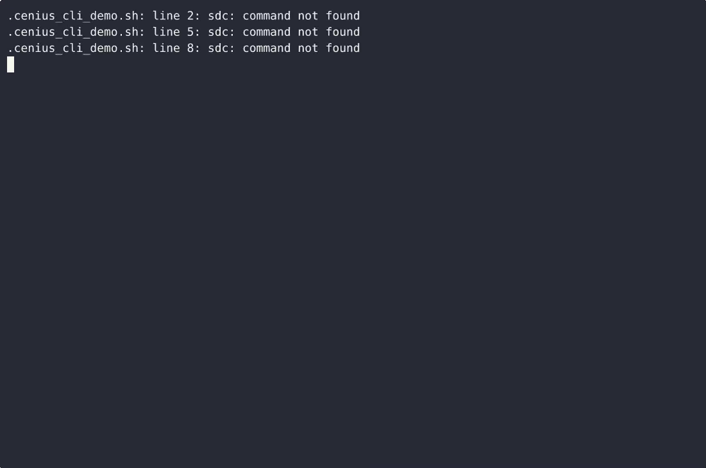

# SourDoughClock — complete Full-stack app command-line tool example app

If you want a self-hosted command-line tool without the vendor lock-in, **SourDoughClock** is ready to run. Built with Full-stack app and Apache-2.0-licensed, SourDoughClock ships complete — one clone, one install command. SourDoughClock is a single-file, standard-library-only Python CLI for home sourdough bakers: it stores named feed-to-bake timer presets keyed by starter hydration and prints the wall-clock bake-ready time, looks up a…. [Open SourDoughClock on cenius.ai](https://cenius.ai/marketplace/p/sourdoughclock?ref=gh&utm_campaign=sourdoughclock-webapp) to customise it without touching a line of SourDoughClock code.


[](LICENSE)  [](https://cenius.ai)

[](https://cenius.ai/marketplace/p/sourdoughclock?ref=gh&utm_campaign=sourdoughclock-webapp)

> **▶ [Open & edit in cenius.ai](https://cenius.ai/marketplace/p/sourdoughclock?ref=gh&utm_campaign=sourdoughclock-webapp)** — one click to an editable workspace: describe changes in plain English, get an instant preview, one-click deploy and host. Modifications made on the platform come with full rebrand & relicense rights.

_Local clone? See [Quick start](#quick-start) below. cenius.ai is the zero-setup path._

## Demo


▶ **[Watch the full demo video](https://cenius.ai/marketplace/p/sourdoughclock?ref=gh&utm_campaign=sourdoughclock-webapp)** — the complete walkthrough, playing on the project's cenius.ai page · [MP4 file](.github/media/demo.mp4)

## Screenshots



## Architecture

Starting up is just `./install.sh`: it installs what is needed and pre-fills the database so you have data to work with straight away. The Full-stack app codebase (26 files) is self-contained — no external services needed to evaluate it. Top-level layout: `tests/`. For environment-specific setup, see [`INSTALL.md`](INSTALL.md).

## Features

- Feed-to-bake timer presets per starter hydration
- Temperature-adjusted rise estimate table
- Batch log with crumb score notes

## Quick start

```bash
./install.sh   # installs dependencies + seeds demo data
```

See [`INSTALL.md`](INSTALL.md) for full setup and usage instructions.

## Usage guide

All examples run from the project root and use `python3 sdc.py`; if `install.sh`
installed the console command, `sdc` alone is equivalent. Add `--no-color` (or
export `NO_COLOR=1`) for plain text.

### 1. Presets: when do I feed, when do I bake?

A preset stores four things: a unique name, the starter hydration, a 24-hour feed
time and a rise duration. The bake time is **derived**, never stored, so it can
never drift from the values you entered.

```bash
python3 sdc.py preset add morning --hydration 100 --feed 22:00 --rise 8
## Preset 'morning' saved: 100% hydration · feed 22:00 · rise 8h · bake 06:00 +1 day
```

```bash
python3 sdc.py preset list
## NAME          │ HYDRATION │ FEED  │ RISE │ BAKE
## ──────────────┼───────────┼───────┼──────┼──────────────
## morning       │      100% │ 22:00 │ 8h   │ 06:00 +1 day
## rye-sunday    │       75% │ 07:30 │ 4.5h │ 12:00
## cold-retard   │      125% │ 20:00 │ 30h  │ 02:00 +2 days
```

Rules the tool enforces — each failure prints one line to stderr, exits 2 and
writes nothing:

| input | message |
|---|---|
| `--feed 25:00` | `feed time must be HH:MM between 00:00 and 23:59 (got '25:00')` |
| `--hydration 40` | `hydration must be between 50 and 150 percent (got 40)` |
| `--rise 60` | `rise hours must be between 1 and 48 (got 60)` |
| duplicate name | `a preset named 'morning' already exists; ... choose a different name` |

Name matching is case-insensitive, so `Morning` and `morning` are the same preset.
Presets are create-and-list only in this version: there is no edit or delete.

_Full guide: [`USAGE.md`](USAGE.md)_

## FAQ

### What's the quickest way to self-host SourDoughClock?

Pull the repo, run `./install.sh`, and you are up — the script installs packages and pre-seeds the database. [`INSTALL.md`](INSTALL.md) covers any platform-specific tweaks.

### Can I build a business on SourDoughClock?

Yes. The code is Apache-2.0-licensed — use it, modify it, and ship it commercially. See [LICENSE](LICENSE).

### What technologies are in SourDoughClock's stack?

SourDoughClock runs on Full-stack app. This repo holds the full production source: you can inspect every part of it before deploying. Highlights include temperature-adjusted rise estimate table.

### Is there a no-code way to modify SourDoughClock?

[cenius.ai](https://cenius.ai/marketplace/p/sourdoughclock?ref=gh&utm_campaign=sourdoughclock-webapp) handles the implementation. Tell it what you want in everyday words, pick up the updated build. No coding needed.

### How do I customise SourDoughClock's branding?

Yes. You can edit the source directly under the MIT license, or [remix it on cenius.ai](https://cenius.ai/marketplace/p/sourdoughclock?ref=gh&utm_campaign=sourdoughclock-webapp) — the platform route grants full rebrand and relicense rights over your derivative.

## License & rebranding

Released under the [Apache License 2.0](LICENSE) (© 2026 Cenius AI) — free for personal and commercial use. The Cenius name/logo are trademarks (see NOTICE).

**Need a customized version?** [Remix this app on cenius.ai](https://cenius.ai/marketplace/p/sourdoughclock?ref=gh&utm_campaign=sourdoughclock-webapp) — modifications made on the platform come with **full rebrand & relicense rights** over your derivative.

## Built with cenius.ai

This entire application — code, design, seeded demo data — was generated on **[cenius.ai](https://cenius.ai)** from a plain-English description.

- 🚀 [Build your own app on cenius.ai](https://cenius.ai)
- 🎛️ [Remix SourDoughClock on the marketplace](https://cenius.ai/marketplace/p/sourdoughclock?ref=gh&utm_campaign=sourdoughclock-webapp) — open it in a workspace, prompt for changes, and ship your own version.

More open-source apps: [the Cenius-ai catalog](https://github.com/Cenius-ai) · [showcase index](https://github.com/Cenius-ai/showcase)
